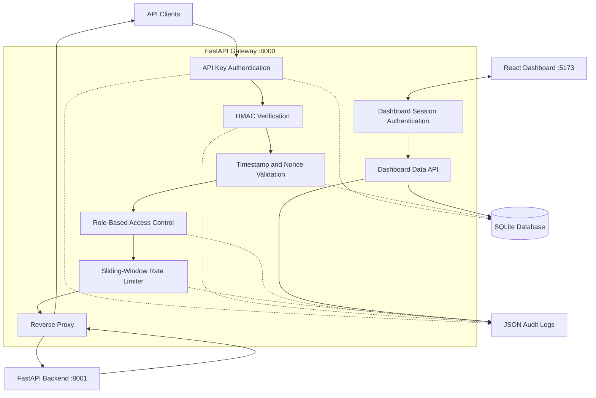

# System Architecture

## Architecture Diagram

## Request Flow

1. A client sends a request to the gateway.
2. API key authentication is performed.
3. HMAC signature, timestamp and nonce are validated.
4. RBAC checks the client's permissions.
5. Rate limiting checks the request quota.
6. Authorized requests are forwarded to the backend.
7. The response is returned and relevant events are logged.

## Services

| Service | Port |
|---|---:|
| React frontend | 5173 |
| FastAPI gateway | 8000 |
| FastAPI backend | 8001 |
